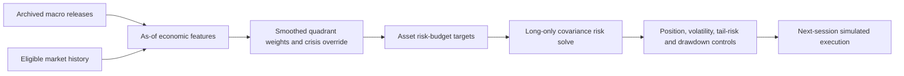

# Macro-aware portfolio construction and cycle tests

**Later V4 refinement:** [INSTITUTIONAL_PORTFOLIO_REFINEMENT.md](INSTITUTIONAL_PORTFOLIO_REFINEMENT.md) adds an All Weather-inspired core, invested Treasury reserve, risk forecast feedback and actual ALLW overlap. V4 lowers full-history volatility but reduces CAGR and worsens maximum drawdown relative to V3. It remains a separate, unaccepted research challenger; the V3 results below are preserved.

**Decision: retain this as a research candidate; do not promote it as the project optimum.** The new engine is implemented and tested, including actual macro vintages and explicit asset risk budgets. Its measured drawdowns are lower than the older long-history baseline, but returns and conditional loss estimates do not establish the requested improvement on all objectives. Production configuration remains unchanged.

## What was constructed

The portfolio uses the existing 26-ETF catalogue. Capital allocations change with observed growth/inflation conditions, market trend, breadth, volatility and a credit-market proxy. SHY, SGOV and SLV are excluded from the risk-bearing allocation; uninvested USD cash is explicit. Other instruments become historically eligible only after 252 complete daily returns. No ETF prices are invented before inception.



The macro inputs are unemployment (`UNRATE`), CPI (`CPIAUCSL`), industrial production (`INDPRO`) and released ten-year/three-month Treasury yields (`DGS10`, `DGS3MO`). Growth combines six-month annualized industrial-production growth, the change in three-month-average unemployment and the yield curve. Inflation direction uses the change in year-over-year CPI. Market confirmation adds SPY trend, five-market breadth, 20-session realized volatility and HYG-versus-LQD performance. The credit proxy also contains rate and other market exposures; it is not a pure credit-spread measure.

Actual archived observations and revisions are selected as of each decision. Date-only releases become usable after the next New York midnight. The yield curve is calculated from its separately archived Treasury components because early vintages of the derived spread were unavailable. [FRED explains historical real-time periods](https://fred.stlouisfed.org/docs/api/fred/realtime_period.html). Frozen input checksums and their cutoff are retained in `var/research/smart-macro-vintages/manifest.json`. No API keys appear in the datasets or reports.

## Switching and risk allocation

Growth and inflation scores produce four normalized, smoothed allocation weights. They are **not calibrated recession probabilities**. Ordinary label changes require 55% confidence, an 8-percentage-point lead, three distinct confirming sessions and ten-session minimum residence. Crisis entry can override immediately on a 10% market drawdown, 25% annualized volatility or a credit/breadth stress combination. Hysteresis controls exit. Duplicate sessions are idempotent; persisted switching state is tied to the configuration hash.

Base economic-group risk shares for research revision 3:

| Regime | Equities | Nominal government bonds | Inflation-sensitive assets | Credit |
|---|---:|---:|---:|---:|
| disinflationary_growth | 75.00% | 10.00% | 10.00% | 5.00% |
| inflationary_growth | 55.00% | 5.00% | 35.00% | 5.00% |
| stagflation | 10.00% | 20.00% | 65.00% | 5.00% |
| deflationary_slowdown | 25.00% | 50.00% | 20.00% | 5.00% |
| crisis | 10.00% | 40.00% | 45.00% | 5.00% |

Outside crisis, the four economic rows are blended using current normalized scenario weights. Equity risk is split between a broad-market core and sector satellites, with a bounded momentum-risk tilt as a candidate parameter. Inflation-sensitive risk is divided among GLD, DBC and TIP; the TIP preference is selected only from past training results. Risk budgets are redistributed within historically eligible groups subject to a 25% maximum per-asset risk share.

The covariance estimator shrinks correlations after standardizing returns and then restores individual variance scales. The allocator solves the positive convex risk-budget problem `0.5*x.T*Sigma*x - sum(b_i*log(x_i))`, normalizes capital weights, and validates percentage Euler risk contributions `w_i*(Sigma*w)_i/(w.T*Sigma*w)` against the declared asset budgets. Maximum absolute contribution error is 0.000001. Group contributions must reconcile too.

Capital constraints: maximum 25% per ETF; no borrowing; normal/neutral/defensive invested-exposure ceilings of 95%/75%/50%. Crisis allows at most 40% invested exposure and a 5% estimated annual volatility ceiling. The selected growth ceiling is 10%; neutral/defensive ceilings are 8%/6%. Estimated daily 95% expected shortfall is capped at 2% normally and 1% in stress by reducing exposure. Cash scaling preserves relative model risk contributions.

Revision 3 uses a trailing 126-session account peak for its drawdown controller: a 5% drawdown reduces exposure/volatility ceilings to 60%/7%; an 8% drawdown reduces them to 25%/4%. A rolling reference permits eventual re-entry and can reset below an earlier all-time high. These are control triggers, **not hard limits on realized losses**. Orders use the following session close in research, so gaps and losses before execution remain possible. Actual realized drawdown reached 10.73%.

Routine rebalancing is every five sessions, with daily breach and crisis checks. Changes below 3% aggregate traded notional can be skipped unless risk limits require action. Risk budgets are validated on proposed trades; holding-period drift does not imply continuous intraday budget equality.

## Research design and selection

The final grid has eight candidates: growth volatility ceilings {10%,12%}, momentum-risk tilts {0%,30%}, and TIP risk preferences {40%,10%}. Every 252 sessions, use only the preceding 756 sessions to select the highest `CAGR - 2*absolute maximum drawdown - 0.15*nonoverlapping quarterly loss frequency`, after doubled trading costs and zero cash interest. Before enough selection history exists, use the fixed seed candidate. The objective expresses one research trade-off; it does not define a universal optimum.

Three development revisions were inspected:

| Revision | Variant runs | Long-history CAGR | Maximum drawdown |
|---|---:|---:|---:|
| smart-portfolio | 4 | 1.89% | -10.06% |
| smart-portfolio-v2 | 4 | 2.82% | -10.68% |
| smart-portfolio-v3 | 8 | 2.92% | -10.73% |

There were **16 smart-strategy variant runs**, in addition to earlier project experiments. Revision 1 exposed persistent cash throttling after recovery; revision 2 added a rolling recovery reference and stronger growth risk allocation; revision 3 tested the inflation-linked risk/capital bottleneck chronologically. Later designs were informed by inspected development results. Neither chronological fitting nor the retained trial log removes this design-selection bias.

The final reserved dates beginning **30 October 2025** remain excluded from return scoring and optimization. The first three years of the extended backtest use the fixed seed, and the 2008 recession is only partially covered. The newer ETF subset changes as instruments accumulate enough actual observations, so this is a historically eligible-universe study, not a claim that today's 26 funds existed throughout.

## Legacy-baseline feasibility and independent references

The legacy comparison's strict filter accepted **40 of 207** proposals and rejected **167**. Its first accepted execution was **1 June 2015**, leaving 1,722 of 4,343 sessions essentially all cash. Its long-period CAGR therefore reflects an important allocation-feasibility problem in this particular exploratory path, not an otherwise fully invested strategy. This is not a full production-pipeline rejection study: the comparison supplied daily Ledoit-Wolf covariance and price-derived regimes. Keep the strict budget tolerance; investigate the original optimizer's final-budget feasibility under its actual pipeline before drawing production-readiness conclusions.

Independent references on the same dates, after 15 bps costs and zero cash interest:

| Reference | CAGR | Volatility | Maximum drawdown |
|---|---:|---:|---:|
| SPY reference | 12.53% | 20.00% | -47.17% |
| 60/40 SPY-IEF reference | 9.08% | 11.31% | -28.30% |

SPY is bought once; the 60/40 reference rebalances every 21 sessions. These references are not constrained to the strategy's 25% ETF position cap. Their daily records and metrics are retained alongside the strategy results.

## Performance and risk results

Net results use 15 bps costs per dollar traded, zero cash interest and adjusted-close execution proxies:

| Model | Start | End | CAGR | Volatility | Maximum drawdown |
|---|---|---|---:|---:|---:|
| Smart macro/risk candidate | 2008-07-28 | 2025-10-29 | 2.92% | 4.31% | -10.73% |
| 14-ETF price-proxy baseline | 2008-07-28 | 2025-10-29 | 3.87% | 6.05% | -20.70% |
| 14 production allocator* | 2022-06-01 | 2025-10-29 | 9.26% | 8.61% | -10.28% |
| 26 diversified allocator* | 2022-06-01 | 2025-10-29 | 4.41% | 4.27% | -5.18% |
| Chronologically selected hybrid | 2022-06-01 | 2025-10-29 | 5.64% | 5.50% | -6.87% |
| Smart macro/risk candidate (matched) | 2022-06-01 | 2025-10-29 | 4.32% | 4.73% | -4.99% |

At doubled 30 bps costs, the final candidate returns **2.59%** annually with **-10.99%** maximum drawdown. Removing the macro features while keeping the same selected parameter schedule gives **2.81%** CAGR and **-9.38%** drawdown. Macro information therefore adds only a small observed return gain here and worsens drawdown; an incremental predictive advantage has not been established.

The recent one-year loss experiment uses 10,000 paired circular block-bootstrap paths with drift-estimation uncertainty, calibrated on the same June 2022–October 2025 dates. These frequencies are conditional simulation outputs, not actual future loss probabilities:

| Model | Simulated one-year terminal-loss frequency | 95th-percentile drawdown magnitude |
|---|---:|---:|
| 14 production allocator* | 16.93% | 13.46% |
| 26 diversified allocator* | 18.32% | 6.89% |
| Chronologically selected hybrid | 17.92% | 8.77% |
| Smart macro/risk candidate | 20.51% | 7.93% |

The smart model has the highest simulated terminal-loss frequency among these four candidates in this calibration. It does not meet the requested evidence standard for simultaneously improving profit and loss probability. Its narrower observed drawdown alone is insufficient grounds to replace the incumbents.

## Regimes and business cycles

NBER dates are retrospective reporting labels and never trading inputs. [NBER documents expansion/recession dates](https://www.nber.org/research/data/us-business-cycle-expansions-and-contractions) and [delayed announcements](https://www.nber.org/research/business-cycle-dating/business-cycle-dating-procedure-frequently-asked-questions). Ordinary switching labels, dominant macro quadrants and business-cycle labels are reported separately; the crisis overlay can mask a stagflation quadrant in the operating label.

| Dominant macro quadrant | Sessions | Conditional compounded return | Daily loss frequency |
|---|---:|---:|---:|
| deflationary_slowdown | 522 | 10.81% | 48.28% |
| disinflationary_growth | 1585 | 16.36% | 46.06% |
| inflationary_growth | 1982 | 27.16% | 45.26% |
| stagflation | 254 | 0.09% | 48.82% |

These quadrant cohorts contain noncontiguous dates. Their compounded returns are attribution totals, not standalone backtests or independently investable strategies. `regime-cycle-results.csv` also reports the worst full-account drawdown observed on labelled days, which can originate in another regime. Contiguous episode comparisons below avoid splicing regimes:

| Episode | Model | Observed start | End | Total return | Episode maximum drawdown |
|---|---|---|---|---:|---:|
| GFC recession, partially covered | Smart macro/risk candidate | 2008-07-28 | 2009-06-30 | -2.05% | -5.51% |
| GFC recession, partially covered | 14-ETF proxy-regime baseline | 2008-07-28 | 2009-06-30 | 0.00% | 0.00% |
| Post-2009 trough first year | Smart macro/risk candidate | 2009-07-01 | 2010-06-30 | 5.77% | -3.07% |
| Post-2009 trough first year | 14-ETF proxy-regime baseline | 2009-07-01 | 2010-06-30 | 0.00% | 0.00% |
| COVID recession | Smart macro/risk candidate | 2020-03-02 | 2020-04-30 | -0.67% | -4.96% |
| COVID recession | 14-ETF proxy-regime baseline | 2020-03-02 | 2020-04-30 | 0.61% | -12.33% |
| Post-2020 trough first year | Smart macro/risk candidate | 2020-05-01 | 2021-04-30 | 5.39% | -2.79% |
| Post-2020 trough first year | 14-ETF proxy-regime baseline | 2020-05-01 | 2021-04-30 | 16.06% | -4.36% |
| 2022 market stress | Smart macro/risk candidate | 2022-01-03 | 2022-12-30 | -8.12% | -10.34% |
| 2022 market stress | 14-ETF proxy-regime baseline | 2022-01-03 | 2022-12-30 | -16.46% | -20.34% |
| 2025 April-May market window | Smart macro/risk candidate | 2025-04-01 | 2025-05-30 | 0.00% | -1.52% |
| 2025 April-May market window | 14-ETF proxy-regime baseline | 2025-04-01 | 2025-05-30 | 2.47% | -6.52% |

## Last simulated allocation and risk shares

The following target was generated at **2025-10-24T20:00:00+00:00** and simulated at the **2025-10-27** close. It is a **historical research target, not a current buy list**. Capital and risk percentages have different meanings; uninvested cash has zero model price variance. The last estimated volatility is **6.74%**, and estimated daily ES95 is **0.97%**.

| Asset | Capital weight | Model risk share |
|---|---:|---:|
| SPY | 7.31% | 14.32% |
| QQQ | 1.49% | 3.18% |
| IWM | 0.76% | 1.59% |
| VEA | 3.50% | 6.36% |
| VWO | 1.92% | 3.18% |
| TLT | 4.62% | 3.98% |
| IEF | 16.12% | 5.30% |
| SHY | 0.00% | 0.00% |
| LQD | 5.75% | 3.90% |
| HYG | 1.74% | 1.10% |
| GLD | 10.36% | 16.33% |
| SLV | 0.00% | 0.00% |
| DBC | 12.95% | 16.33% |
| VNQ | 0.90% | 1.59% |
| TIP | 10.83% | 3.63% |
| IGOV | 6.88% | 3.98% |
| SGOV | 0.00% | 0.00% |
| XLF | 1.10% | 1.70% |
| XLP | 1.97% | 1.70% |
| XLE | 0.84% | 1.70% |
| XLU | 1.31% | 1.70% |
| XLI | 1.01% | 1.70% |
| KIE | 1.14% | 1.70% |
| ITB | 0.85% | 1.70% |
| EWJ | 0.85% | 1.59% |
| XLY | 0.83% | 1.70% |
| USD_CASH | 5.00% | 0.00% |

## Validation and project decision

The final run generated **1026** simulated trade events, with **zero rejected proposals** and maximum asset-budget error **9.11e-12**. Source/data hashes, archive hashes, capital accounting, risk-share caps, group reconciliation and next-session timestamps were independently checked. The software suite passed **1,132 tests**. Tests cover actual release availability, future revisions/prices, timestamp-unit caching, eligible assets, exact risk budgets, tail limits, chronology, state restoration, duplicate-session idempotence and credential redaction.

These are engineering results, not strategy approval. `replacement-assessment.json` records **INSUFFICIENT_EVIDENCE_FOR_REPLACEMENT**; it is not an operator-signed qualification receipt. Paper configuration, its canonical 14-asset universe and existing authorization gate were not changed.

Before selecting a project default: specify the owner's numerical return/drawdown/loss-frequency acceptance trade-off; freeze this design; validate on genuinely new observations with realistic execution/cash carry and calibration uncertainty; test sector/duration/FX look-through and correlation shocks; integrate fresh released macro data, persisted state and the new expanded-universe account risk contract through the paper authorization/reconciliation path. A further search on the same inspected dates must remain labelled development research.

## Implementation and rerun

- `smartregimeportfolio.py`: point-in-time features, stateful switching and the explicit risk-budget allocator.
- `fetch_strategy_macro.py`: paginated/windowed immutable macro download; protected credential handling.
- `research/smart_regime_portfolio*.json`: versioned risk contracts and candidate grids.
- `research/smart_strategy_experiments.json`: all three inspected revisions.
- `optimize_smart_portfolio.py`: causal selection, risk controls, audits, cycle reporting, ablation and paired loss simulation.
- `test_smart_regime_portfolio.py`: focused validation.

```sh
python3 optimize_smart_portfolio.py --config research/smart_regime_portfolio_v3.json --output var/research/smart-portfolio-v3
python3 -m pytest -q test_smart_regime_portfolio.py test_macrovintage.py
```

The frozen macro files end at the historical research cutoff. A future paper adapter must refresh its inputs; stale archives will not support a current decision.


